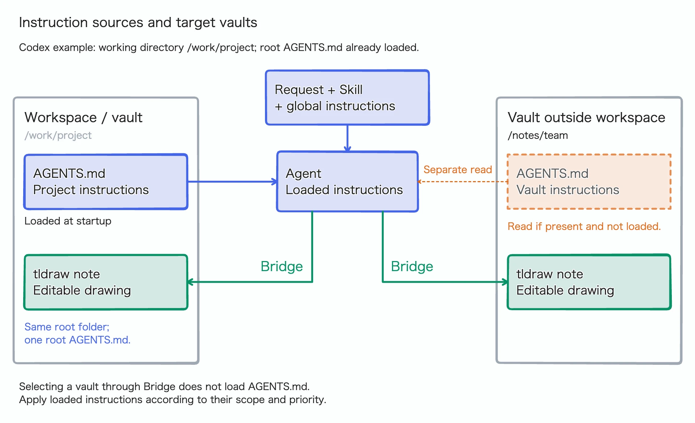

# Agent instruction scope

**Bridge's vault selection sets the editing target. It does not load agent
instruction files.** Customize drawing and exports through the conversation or
instructions the agent loads, applying each instruction within its scope and
priority.

At startup, Codex loads global instructions and discovers project instructions
along the path from the project root to its working directory. See the
[official discovery rules](https://learn.chatgpt.com/docs/agent-configuration/agents-md#how-codex-discovers-guidance).



This example assumes Codex's working directory is `/work/project` and its root
`AGENTS.md` is already loaded. The workspace is the project folder; the
marketplace-installed Skill is separate. The [editable tldraw note](diagrams/agent-instruction-scope.md)
contains the diagram's shapes and connections.

## Path examples

For these examples, the working directory is `/work/project`.

| Vault root | Instruction loading |
| --- | --- |
| `/work/project` | Workspace and vault share the same root `AGENTS.md`, loaded in this example. |
| `/work/project/notes` | Its own `AGENTS.md` is outside startup discovery from `/work/project`; read it separately if needed. |
| `/notes/team` | Selecting this vault does not load its `AGENTS.md`; read it separately if needed. |

## Load instructions from another vault

For example, tell the agent:

> Use the Team vault. Before drawing, read `/notes/team/AGENTS.md` if present
> and apply its drawing and export instructions to this task. Report any read
> failure.

For repeated use, put this instruction in the workspace's `AGENTS.md`, using the
intended vault's actual path.

## Example drawing and export instructions

Place this in guidance the agent will load:

```markdown
## tldraw drawing and exports

- Batch small edits before exporting a preview for visual inspection.
- Inspect a structural draft and the final rendering; inspect again after fixes
  to clipping, overlap, or connections.
- Show preview images in the conversation at the draft and final stages.
- Deliver PNG with an actual image width near 1600 pixels; use --format png.
- Keep intermediate previews in a temporary directory and final images beside
  their editable notes.
```

Exporting for inspection and showing an image in the conversation are separate
actions. Specify both frequencies if that matters. The current `preview` command
defaults to WebP and also supports PNG; the filename extension does not select
the format. See [image preview options](../integrations/codex/skills/obsidian-tldraw/references/operations.md#image-preview).
