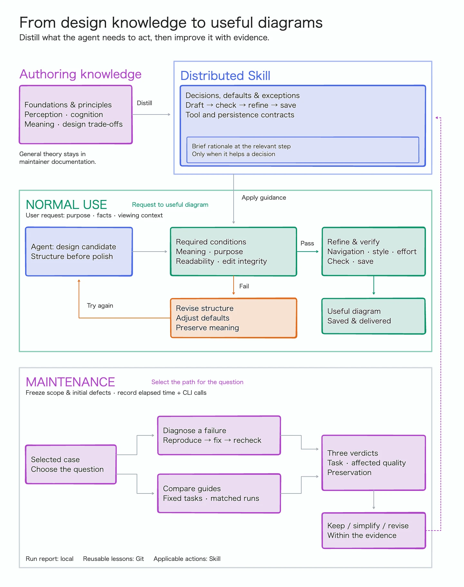

# Diagramming guide design system

This diagram explains the design model behind the drawing guidance, how its
completion conditions and defaults guide individual decisions, and how
maintainer evaluations can improve it.

Normal use starts with a user's request and ends with delivering a checked,
saved diagram for that user's purpose. Maintenance is separate: choose local
diagnosis and targeted checks for a concrete failure, or matched comparisons
for a question about guide quality. Ordinary outputs do not automatically enter
either maintenance path.



The editable source is the [Obsidian tldraw note](diagrams/diagramming-guide-design-system.md).
Keep that note and its WebP preview together in Git. The image is a flattened
preview; the note contains the editable shapes and connections.

## Model and implementation

The diagram follows the path from maintainer knowledge to a focused Skill,
and from a user task to a delivered diagram. Its structure distinguishes who
uses the knowledge and when, rather than prescribing four layers to read.

- **Authoring knowledge:** foundations, design principles, and extended rationale
  help maintainers design the guidance. General theory belongs primarily in
  maintainer documentation.
- **Distributed Skill:** include decisions, project defaults, exceptions,
  workflow, quality checks, and tool/persistence contracts that help the agent
  act correctly.
- **Local reasoning cues:** a short rationale or principle may sit inside the
  relevant rule or workflow step when it helps a decision. These cues are
  optional; they do not form a separate theory layer to load.
- **Normal use:** the agent applies the guidance to the user's purpose, facts,
  and viewing conditions. A candidate is checked against required meaning,
  purpose, readability, and edit-integrity conditions. Failure returns to
  structural revision and another check; defaults may be adjusted while meaning
  is preserved. Passing candidates proceed to refinement, verification, saving,
  and delivery.
- **Maintenance:** select a case and a question, freeze editable/protected
  records and initial defects, and record elapsed time and CLI calls. Diagnose
  failures through minimal reproduction and targeted checks; compare guides on
  matched tasks and conditions. Assess task success, affected quality, and
  preservation separately, then keep, simplify, or revise guidance within the
  evidence's scope. Do not infer visual quality from record equality or general
  guide superiority from a local repair.

Rules, workflow, and useful brief cues are implemented in the canonical Skill's
[diagramming index](../integrations/codex/skills/obsidian-tldraw/references/diagramming/index.md).
SDK-specific guidance remains in
[tldraw.md](../integrations/codex/skills/obsidian-tldraw/references/diagramming/tldraw.md),
with editing and persistence contracts in
[operations.md](../integrations/codex/skills/obsidian-tldraw/references/operations.md).

The [production workflow](../integrations/codex/skills/obsidian-tldraw/references/diagramming/index.md#production-workflow)
defines the check–revise loop and saved delivery, including rechecking after
refinement and preserving unrelated content during local edits. The
[maintainer policy](development.md#maintaining-diagramming-guidance) defines
what to distill into the Skill and when to use a separate comparison.

| Scope | Contents | Plugin distribution |
| --- | --- | --- |
| Authoring knowledge | General foundations, design principles, and extended rationale used to design and maintain the Skill | Generally excluded as standalone theory |
| Runtime guidance | Drawing rules, project defaults, workflow, quality checks, SDK notes, operation contracts | Included |
| Brief reasoning cues | A short rationale or principle placed inside a rule or workflow step when it helps a decision | Included selectively within rules and workflow |
| CLI and runtime | Bundled command entrypoint and bridge implementation | Included |
| Per-diagram inputs | Requested purpose, audience, viewing conditions, source facts | Supplied at use time |
| User diagram outputs | Checked and saved diagrams delivered for the user's purpose | Not bundled; may be shared or tracked separately |
| Maintainer evaluations | Prompts, fixtures, scope classifications, report template, rubric, and repository-only recorder | Excluded |
| Repository documentation | This page, the editable diagram, its preview, and proposals | Excluded |

The [evaluation kit](evaluations/diagramming/README.md) separates local execution
reports from [reusable lessons](evaluations/diagramming/findings.md) and runtime
guidance. Keep individual results and artifacts under `workspace/evaluations/`;
use the [report template](evaluations/diagramming/report-template.md) for each run.
The diagram describes the maintenance process, not a measured general quality
improvement.

## Edit and refresh the preview

Open the source in Obsidian with the tldraw plugin and edit its named
`From design knowledge to useful diagrams` frame. For bridge edits, use the current
Skill's revision, inspection, and persistence procedures. Do not replace the
embedded drawing JSON by hand.

From the repository root, using the registered vault containing this checkout:

```sh
python3 bridge.py --vault obsidian-tldraw-bridge open docs/diagrams/diagramming-guide-design-system.md
python3 bridge.py --vault obsidian-tldraw-bridge preview docs/diagrams/diagramming-guide-design-system.md --ids shape:guide-system --scale 0.5 --output docs/diagrams/diagramming-guide-design-system.webp
python3 bridge.py --vault obsidian-tldraw-bridge close docs/diagrams/diagramming-guide-design-system.md
```

The frame is 1440 × 1820 canvas units. At scale 0.5 with SDK raster pixel ratio 2,
the output is 1440 × 1820 pixels. Check readable text, label/line clearance,
arrow endpoints, and package-boundary labels before committing both artifacts.
One-off editing scripts and draft exports remain local under ignored `workspace/`;
they are not required to open or edit the saved diagram.
