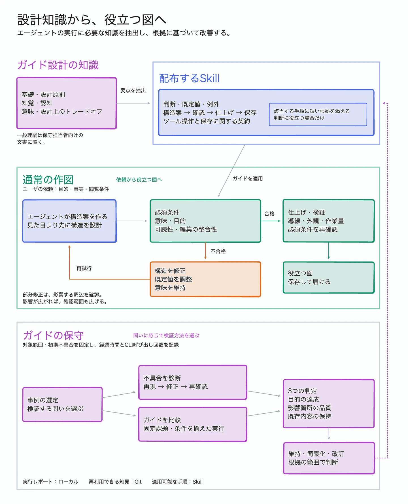
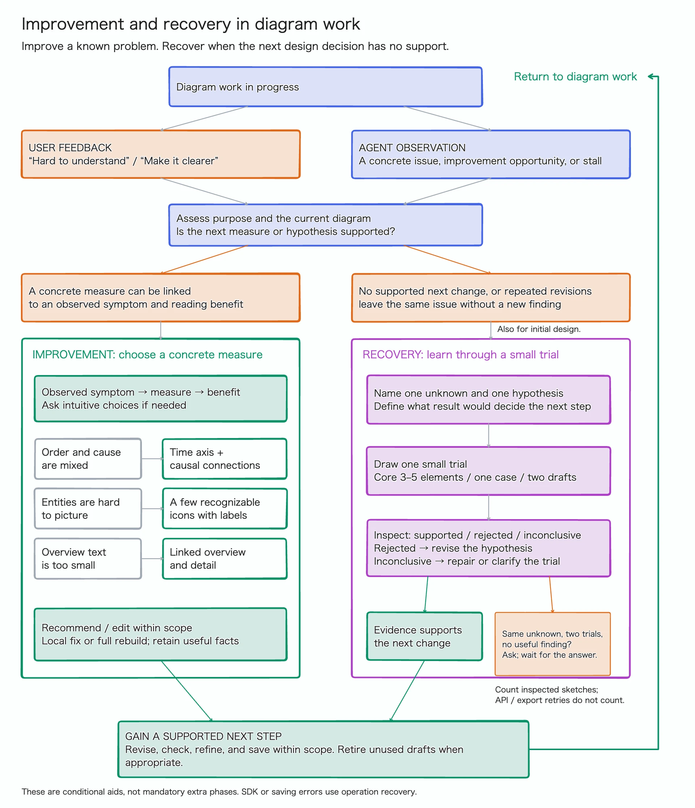

# Diagramming guide design system

This diagram explains the design model behind the drawing guidance, how its
completion conditions and defaults guide individual decisions, and how
maintainer evaluations can improve it.

Normal use starts with a user's request and ends with delivering a checked,
saved diagram for that user's purpose. Maintenance is separate: choose local
diagnosis and targeted checks for a concrete failure, or matched comparisons
for a question about guide quality. Ordinary outputs do not automatically enter
either maintenance path.


The editable source is the [Obsidian tldraw note](diagrams/diagramming-guide-design-system.md).
Keep that note and its language previews together in Git. The images are flattened
previews; the note contains the editable shapes and connections.

## Language pages

The same note contains two pages for diagram ID
`diagramming-guide-design-system`:

| Language | Page name | Page ID | Frame ID | Preview |
| --- | --- | --- | --- | --- |
| English (editing source) | Design system / English | `page:page` | `shape:guide-system` | [English](diagrams/diagramming-guide-design-system.webp) |
| Japanese | Design system / 日本語 | `page:guide-design-system-ja` | `shape:ja-guide-system` | [日本語](diagrams/diagramming-guide-design-system.ja.webp) |



Each language has one page for this diagram ID. Review the whole diagram's
context only when that language is needed, updating its existing page rather
than creating a new note or a page for each revision. Initial translation may
copy the whole diagram; later updates must read the existing target and preserve
valid translations, shape identities, and language-specific layout adjustments.
Other diagrams can use separate diagram IDs in the same note without sharing
this diagram's editing source or translation state.

Use `language-status` to inspect the language pages, and `language-checkpoint`
only after both pages have been reviewed. See the [multilingual workflow](multilingual.md)
for identity, statuses, checkpointing, and commit review. Existing generation
hashes and `layoutReview` metadata remain readable; they are not an automated
translation or notification service.

A layout fix found while translating may also improve the source language. Apply
it to either or both pages when appropriate, preserve existing wording and meaning,
and verify/export every affected language. Language-specific line wrapping and
box widths can differ. Always read the target before reflection and retain valid
unchanged translations; a hash mismatch alone never authorizes an overwrite.

## Improvement and design recovery

The same editable note also contains a separate diagram,
`diagram-improvement-recovery`, with **ongoing diagram creation and improvement**
as its starting state. **User feedback** or **agent observation** leads to
assessment of the purpose and current diagram, then
to improvement or design recovery according to the available evidence. This
supplement does not repeat the main diagram's normal-use lifecycle. The original
design-system pages are unchanged.

- **Improvement:** connect an observed symptom to a concrete measure and expected
  reader benefit. Examples include separating chronology from causality, adding
  selective labeled icons, and separating overview from detail. Propose or edit
  within the user's scope; a request for suggestions alone ends with a proposal.
- **Design recovery:** when the next change has no testable rationale, or repeated
  fixes leave the same difficulty unresolved without a useful new finding,
  isolate an unknown, draw a small
  trial, and inspect what it establishes. Change a rejected hypothesis; after
  two trials without a useful finding, ask for one missing choice or fact and
  wait for a required answer. Recovery can also precede the first structural draft.

A known correction and equivalent acceptable layouts stay in ordinary work.
Count inspected design trials, not API calls or export retries; an informative
rejection that narrows the next choice is progress. The
[targeted decision cases](evaluations/diagramming/README.md#targeted-improvement-and-recovery-checks)
cover these boundaries separately from drawing-quality comparisons.

Once evidence supports the next design choice, proceed with that step within
the requested scope. An upward return arrow along the outer edge reconnects to
the starting state. These are not mandatory extra phases, and SDK/connection/saving failures
use operation recovery instead. The agent-facing sources are
[improvement conversations](../integrations/codex/skills/obsidian-tldraw/references/diagramming/improvement-patterns.md)
and [design recovery](../integrations/codex/skills/obsidian-tldraw/references/diagramming/design-recovery.md).

The editable source is the [Obsidian tldraw note](diagrams/diagramming-guide-design-system.md).



Select the corresponding page before exporting its named frame. Frames
`improvement-and-recovery` and `improvement-and-recovery.ja` match their preview
filenames. Both are 1600 × 1860 canvas units; export at scale `0.6` for a width of
1920 pixels with the SDK's raster pixel ratio of 2. Keep draft exports outside
tracked documentation, and update the editable note and affected previews together.

## Model and implementation

The diagram follows the path from maintainer knowledge to a focused Skill,
and from a user task to a delivered diagram. Its structure distinguishes who
uses the knowledge and when, rather than prescribing four layers to read.

- **Authoring knowledge:** foundations, design principles, and extended rationale
  help maintainers design the guidance. General theory belongs primarily in
  maintainer documentation.
- **Distributed Skill:** include decisions, project defaults, exceptions,
  workflow, quality checks, and tool/persistence contracts that help the agent
  act correctly.
- **Local reasoning cues:** a short rationale or principle may sit inside the
  relevant rule or workflow step when it helps a decision. These cues are
  optional; they do not form a separate theory layer to load.
- **Normal use:** the agent applies the guidance to the user's purpose, facts,
  and viewing conditions. A candidate is checked against required meaning,
  purpose, readability, and edit-integrity conditions. Failure returns to
  structural revision and another check; defaults may be adjusted while meaning
  is preserved. Passing candidates proceed to refinement, verification, saving,
  and delivery.
- **Maintenance:** select a case and a question, freeze editable/protected
  records and initial defects, and record elapsed time and CLI calls. Diagnose
  failures through minimal reproduction and targeted checks; compare guides on
  matched tasks and conditions. Assess task success, affected quality, and
  preservation separately, then keep, simplify, or revise guidance within the
  evidence's scope. Do not infer visual quality from record equality or general
  guide superiority from a local repair.

Rules, workflow, and useful brief cues are implemented in the canonical Skill's
[diagramming index](../integrations/codex/skills/obsidian-tldraw/references/diagramming/index.md).
SDK-specific guidance remains in
[tldraw.md](../integrations/codex/skills/obsidian-tldraw/references/diagramming/tldraw.md),
with editing and persistence contracts in
[operations.md](../integrations/codex/skills/obsidian-tldraw/references/operations.md).

The [production workflow](../integrations/codex/skills/obsidian-tldraw/references/diagramming/index.md#production-workflow)
defines the check–revise loop and saved delivery, including rechecking after
refinement and preserving unrelated content during local edits. The
[maintainer policy](development.md#maintaining-diagramming-guidance) defines
what to distill into the Skill and when to use a separate comparison.

| Scope | Contents | Plugin distribution |
| --- | --- | --- |
| Authoring knowledge | General foundations, design principles, and extended rationale used to design and maintain the Skill | Generally excluded as standalone theory |
| Runtime guidance | Drawing rules, project defaults, workflow, quality checks, SDK notes, operation contracts | Included |
| Brief reasoning cues | A short rationale or principle placed inside a rule or workflow step when it helps a decision | Included selectively within rules and workflow |
| CLI and runtime | Bundled command entrypoint and bridge implementation | Included |
| Per-diagram inputs | Requested purpose, audience, viewing conditions, source facts | Supplied at use time |
| User diagram outputs | Checked and saved diagrams delivered for the user's purpose | Not bundled; may be shared or tracked separately |
| Maintainer evaluations | Prompts, fixtures, scope classifications, report template, rubric, and repository-only recorder | Excluded |
| Repository documentation | This page, the editable diagram, its preview, and proposals | Excluded |

The [evaluation kit](evaluations/diagramming/README.md) separates local execution
reports from [reusable lessons](evaluations/diagramming/findings.md) and runtime
guidance. Keep individual results and artifacts under `workspace/evaluations/`;
use the [report template](evaluations/diagramming/report-template.md) for each run.
The diagram describes the maintenance process, not a measured general quality
improvement.

## Edit and refresh the preview

Open the source in Obsidian with the tldraw plugin and choose a language page.
The English frame is named `From design knowledge to useful diagrams`; the
Japanese frame is named `diagramming-guide-design-system.ja`, matching its export
filename. For bridge edits, use the current Skill's revision, inspection, and
persistence procedures. Do not replace the embedded drawing JSON by hand.

Preview exports the dedicated bridge Editor's current page. Select the intended
page with `apply` / `setCurrentPage` before exporting; choosing a GUI tab alone
does not select the bridge's page. In these examples, `bridge.py` means the
installed Skill's CLI entrypoint. Replace `CURRENT_REVISION` with the revision
returned by the immediately preceding observation.

From the repository root, using the registered vault containing this checkout:

```sh
python3 bridge.py --vault obsidian-tldraw-bridge open docs/diagrams/diagramming-guide-design-system.md
python3 bridge.py --vault obsidian-tldraw-bridge observe docs/diagrams/diagramming-guide-design-system.md
python3 bridge.py --vault obsidian-tldraw-bridge apply docs/diagrams/diagramming-guide-design-system.md --revision CURRENT_REVISION --input - <<'JSON'
[{"op":"setCurrentPage","pageId":"page:page"}]
JSON
python3 bridge.py --vault obsidian-tldraw-bridge preview docs/diagrams/diagramming-guide-design-system.md --ids shape:guide-system --scale 0.5 --output docs/diagrams/diagramming-guide-design-system.webp
```

For the Japanese preview, observe again to obtain the current revision, then:

```sh
python3 bridge.py --vault obsidian-tldraw-bridge apply docs/diagrams/diagramming-guide-design-system.md --revision CURRENT_REVISION --input - <<'JSON'
[{"op":"setCurrentPage","pageId":"page:guide-design-system-ja"}]
JSON
python3 bridge.py --vault obsidian-tldraw-bridge preview docs/diagrams/diagramming-guide-design-system.md --ids shape:ja-guide-system --scale 0.5 --output docs/diagrams/diagramming-guide-design-system.ja.webp
python3 bridge.py --vault obsidian-tldraw-bridge close docs/diagrams/diagramming-guide-design-system.md
```

Both frames are approximately 1440 × 1779.3 canvas units after applying the
user's layout adjustments. At scale 0.5 with SDK raster pixel ratio 2, each
export has a width of 1440 pixels and a height based on that language's frame.
Reinspect current bounds after edits rather than enforcing identical heights.
Check readable text, label/line clearance,
arrow endpoints, and package-boundary labels before committing the note and
updated language previews.
One-off editing scripts and draft exports remain local under ignored `workspace/`;
they are not required to open or edit the saved diagram.
