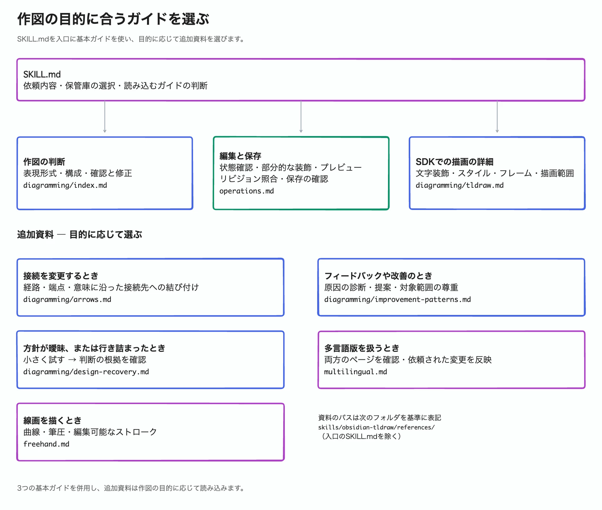

# Skill knowledge map

This map shows which bundled knowledge Codex consults for your drawing task.
Paths refer to the installed `skills/obsidian-tldraw/` Skill.

Codex starts at `SKILL.md`, then uses three basic guides for drawing decisions,
editing and saving, and SDK drawing details. It selects extra references by task:
connections, improvement, design recovery, language variants, or freehand drawing.
These references have their own conditions; you need not read every
file yourself. The [editable tldraw note](diagrams/skill-knowledge-map.md) contains
English and Japanese pages for diagram ID `skill-knowledge-map`:

| Language | Page name | Export frame | Preview |
| --- | --- | --- | --- |
| English (editing source) | Skill knowledge map (en) | `skill-knowledge-map` | [English](diagrams/skill-knowledge-map.webp) |
| Japanese | Skill knowledge map (ja) | `skill-knowledge-map.ja` | [日本語](diagrams/skill-knowledge-map.ja.webp) |

Keep both pages and their previews together. Review existing translations before
reflecting later changes; see the [multilingual workflow](multilingual.md).

The installed plugin contains `plugin.json` and the Skill directory; the Skill
contains `SKILL.md`, `references/` (knowledge), and `scripts/` (bundled tools).
See [setup and usage](../README.md#setup-and-usage) for prerequisites and the
existing [architecture diagram](diagrams/architecture.md) for execution and saving.
