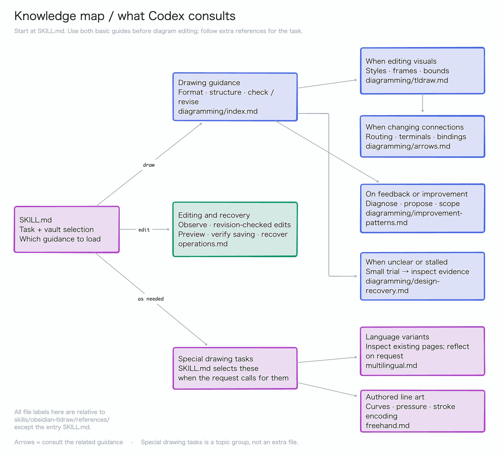

# Skill knowledge map

This map shows which bundled knowledge Codex consults for your drawing task.
Paths refer to the installed `skills/obsidian-tldraw/` Skill.

Codex starts at `SKILL.md`, uses the drawing and editing guides, and follows
extra references for the task. Improvement, design recovery, language variants,
and freehand drawing each have their own conditions; you need not read every
file yourself. The [editable tldraw note](diagrams/skill-knowledge-map.md) contains
one page, `Skill knowledge map`, with frame `skill-knowledge-map`.

The installed plugin contains `plugin.json` and the Skill directory; the Skill
contains `SKILL.md`, `references/` (knowledge), and `scripts/` (bundled tools).
See [setup and usage](../README.md#setup-and-usage) for prerequisites and the
existing [architecture diagram](diagrams/architecture.md) for execution and saving.
